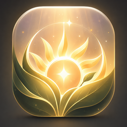

<p align="center">
  
</p>

<h1 align="center">Sunshine</h1>

<p align="center">Custom skins, saved accounts and everyday tools for League of Legends.</p>

<p align="center">
  <a href="https://github.com/Yimikami/Sunshine/releases/latest"><strong>Download for Windows</strong></a> ·
  <a href="https://discord.gg/8zsgZUxVgW">Discord</a> ·
  <a href="https://github.com/Yimikami/Sunshine/issues/new/choose">Report a bug</a> ·
  <a href="https://github.com/sponsors/Yimikami">Sponsor</a>
</p>

## Get started

1. Download `Sunshine_<version>_x64-setup.exe` from the [latest release](https://github.com/Yimikami/Sunshine/releases/latest).
2. Install Sunshine, then open League of Legends.
3. In **Settings → Game setup**, use **Auto-detect** or select your League installation.
4. Open **Skin Changer**, choose your skins, then use **Apply & Inject** before your match.

**Windows 10/11, 64-bit.** To update, run the latest installer over your existing installation. If an older version cannot update after the repository move, download the installer directly from [Yimikami/Sunshine releases](https://github.com/Yimikami/Sunshine/releases/latest).

## Languages

Sunshine's interface supports **English, Turkish, Simplified Chinese, German, French, Spanish, Portuguese (Portugal), and Italian**. On first launch, Sunshine uses the Windows display language when it has a matching translation; otherwise it uses English. Choose another language in **Settings → General → App language**. Your choice is saved for future launches and does not change the language of League of Legends. Traditional Chinese and other unsupported display languages use English until you choose a supported language.

## What you can do

- **Skin library** — browse champion skins, chromas, League Classic skins, emotes and wards. Choose stages and alternate appearances from a skin's **Forms** list, and review your selected skins in the Dashboard carousel.
- **Custom skins** — browse the marketplace or import `.fantome` and `.modpkg` files. Custom skins show their own cover or loading-screen artwork when available.
- **Skin repair** — use **Repair skin** to check and fix supported problems, or enable automatic repair for imports and marketplace downloads. Your original files are kept.
- **3D previews** — inspect installed skins, play animations and preview supported effects before applying them.
- **Workshop** — start from a champion and skin of your choice, an installed custom skin or a skin file. Edit textures, colors, icons, loading-screen artwork and supported effects, show or hide model parts, then export with your own name and description. **Advanced Workshop** adds more detailed model, HUD and effect controls.
- **AI and Blender support** — connect a compatible AI assistant through **Settings → MCP** to work on Workshop projects. Optional Blender setup lets you edit compatible models externally and bring them back.
- **Party** — share skin selections over encrypted peer-to-peer (P2P) connections, with relay fallback when needed. Optional automatic sync downloads supported catalog skins and keeps selections in sync. Custom skins must be installed locally.
- **TFT (experimental)** — browse supported companions and apply their appearances directly from Sunshine.
- **Saved accounts** — sign in through the official Riot Client, organize accounts with favorites and notes, view rank history, and create password-protected backups. Complete any CAPTCHA or two-factor verification in Riot Client.
- **Automation** — configure auto-accept, champion picks and bans, including preferences for individual accounts.
- **Lobby tools** — look up players during champion select and live games.
- **Personalization** — customize the theme and choose whether to show your activity on Discord.

Skins, forms, emotes and wards come from the [Sunshine skin collection](https://github.com/bettie9/LeagueSkins). Sunshine installs and updates **LTK Patcher** automatically. For normal champion skins, keep the champion's default skin selected in League. If tool setup needs attention, use **Settings → Support → Check tool updates**.

## Need help?

Join [Discord](https://discord.gg/8zsgZUxVgW) or [open an issue](https://github.com/Yimikami/Sunshine/issues/new/choose). Include your Sunshine version and what went wrong. Save support logs from **Settings → Support → Save support logs** and review them before sharing.

For a broken skin package or a missing skin or form, use the [LeagueSkins issue forms](https://github.com/bettie9/LeagueSkins/issues/new/choose). See the [release notes](https://github.com/Yimikami/Sunshine/releases) for updates, or open **Settings → Support → Release notes** to read the notes for your installed version.

<details>
<summary>Uninstall</summary>

Remove Sunshine through **Windows Settings → Apps**, or run:

```powershell
irm https://raw.githubusercontent.com/Yimikami/Sunshine/main/uninstall.ps1 | iex
```

The script asks before deleting your saved skins and settings.

</details>

---

Sunshine is an independent project and is not affiliated with Riot Games. Custom skins are visible only on your own client. The skin collection is maintained at [bettie9/LeagueSkins](https://github.com/bettie9/LeagueSkins); its attribution and licensing remain with that project.
